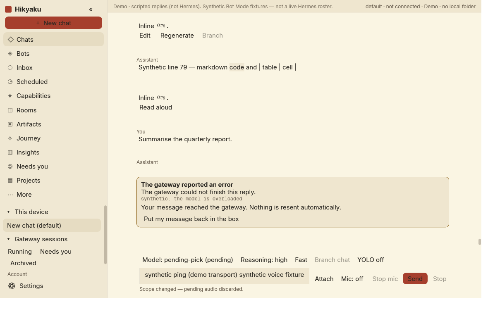
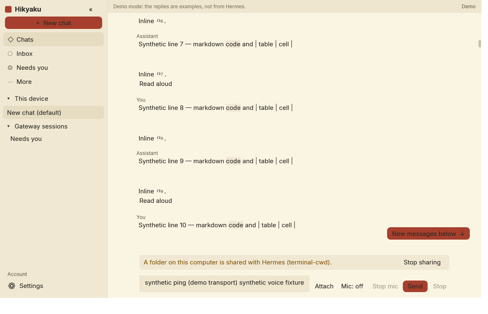
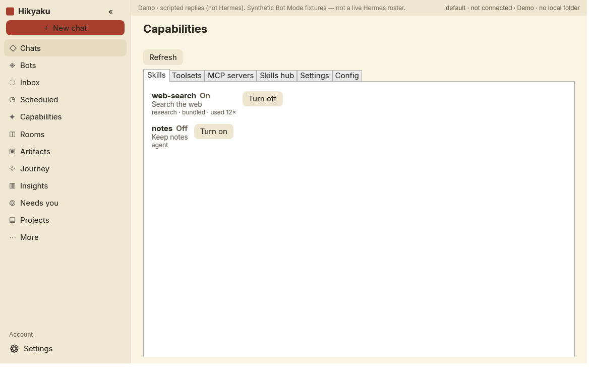

# Hikyaku for Windows

Hikyaku (飛脚, the old Japanese relay courier) is a native Windows desktop client for a **Hermes Agent gateway** that you
already run somewhere else: on a home server, a VPS or another PC. Hikyaku runs on your Windows PC and talks to the gateway's
dashboard over the network; it does not run an agent itself.

It is an independent, community-built client. It is not made by or affiliated with Nous Research.



## Status

**v0.7.0.** Everything has been built against the published Hermes protocol and tested with
automated tests against a simulated gateway (about 1,250 tests), and it is in daily use on one real gateway. Expect rough
edges with other servers and please report them (see below); fixes arrive as in-app updates.

## What it does

- **Chats** with your Hermes agents: streaming replies, maths (TeX), attachments, voice dictation, read aloud, copy, edit and
  regenerate, branch, find in chat, steer or queue a message while a reply is running, and clear cards when a reply fails.
  Nothing is ever resent automatically.
- **Inbox** for the results of your scheduled jobs: what each run found at a glance, failures marked, unread dots, opened in
  place or asked about in a chat (the optional `hikyaku-cron` Hermes plugin shows script-only jobs' whole output), and **Needs you** for
  approvals and questions the agent is waiting on, with Windows notifications if you turn them on.
- **Folders on this PC**, while Hikyaku is open: Hermes can list, read, and write inside folders you allow. Hikyaku asks
  the first time, a delete asks every time, and the files stay on your PC. The optional `hikyaku-files` plugin is what the agent calls.
- **Advanced tools** for whoever looks after the gateway: scheduled jobs, skills, toolsets and MCP servers, the skills hub,
  a settings editor and `config.yaml` editor, insights, hosted rooms, artifacts, the memory graph (Journey), and local
  projects with folder sharing, Git checkpoints and a local terminal.
- Six Hokusai-inspired themes with light and dark variants, larger text sizes, keyboard shortcuts (Ctrl+K palette,
  Ctrl+N, Ctrl+F and more; Ctrl+/ lists them) and respect for Windows reduced-motion and high-contrast settings.

## Simple and Advanced

Hikyaku has two views, chosen in **Settings → View**:

| | Simple | Advanced |
|---|---|---|
| For | everyday chatting, including people new to computers | managing Hermes |
| Shows | Chats, voice chat, Inbox, Needs you, sign in, appearance, updates | everything |
| Gateway changes | answering approvals, chat housekeeping (rename, pin, delete) | all settings and admin pages |

A new installation starts in Simple. Simple is a **view, not a lock**: anyone at the PC can switch with one click. For real
separation, give each person their own Hermes profile and Windows account. A risk that is already switched on is shown in
Simple too, with a button to turn it off: YOLO turned on in a chat from this app, a folder shared with Hermes, an open
terminal, or approvals turned off for the profile. (YOLO turned on from another client, or before Hikyaku was restarted,
is not read back from the gateway yet.)



## Requirements

- Windows 10 or 11, 64-bit (x64).
- A Hermes Agent gateway with its web dashboard reachable from your PC (on your network, through a VPN, or behind
  Cloudflare Access), and a dashboard username and password, or a gateway that offers browser sign-in.
- Nothing else: the app is self-contained, so **no .NET installation is needed**.

## Install

1. Download `Hikyaku-Setup-X.Y.Z.exe` from the [latest release](https://github.com/BookahCoding/Hikyaku/releases/latest).
2. Run it. Windows SmartScreen may warn that the app is unrecognised, because the installer is not Authenticode-signed;
   choose **More info → Run anyway** if you trust this download.
3. It installs for **your Windows account only**, without administrator rights, into `%LOCALAPPDATA%\Programs\Hikyaku`,
   and adds Hikyaku to the Start menu. Each person on the PC who wants Hikyaku runs the installer in their own account.
   Uninstall from Windows Settings → Apps; your settings and sign-in (`%APPDATA%\Hikyaku`) are kept.

Prefer no installer? `Hikyaku-win-x64.zip` on the same page is the same build: unzip it into a folder your own account can
write to and run `Hikyaku.exe` (the in-app updater cannot update a copy under `Program Files`).

## Connect to your gateway

1. Open **Settings** (Ctrl+,). A new installation shows the connection fields even in Simple view.
2. Enter a name for the gateway (just a label) and the **dashboard address**, for example `https://hermes.example.com/`.
3. Either enter your dashboard **username and password** and choose **Sign in and discover profiles**, or choose
   **Sign in with browser** if your gateway offers it.
4. If the gateway is behind **Cloudflare Access**, add a service token under Settings → Cloudflare Access (Advanced) and
   use **Test connection**.
5. **Tick the profiles to show on this PC.** Only ticked profiles appear anywhere in Hikyaku; new profiles are never
   ticked automatically.
6. **Save.** Hikyaku connects and lists your chats.

## Security and privacy

- **Stored on your PC, per Windows user** (`%APPDATA%\Hikyaku`): settings, the chosen profiles, the dashboard password and
  sign-in tokens and any Cloudflare Access token (encrypted with Windows DPAPI, readable only by your Windows account),
  offline copies of recent chats (DPAPI-encrypted), unsent drafts and the jobs you hid from the Inbox (plain JSON).
- **Safety copies of `config.yaml`**: before the Advanced config editor overwrites the gateway's `config.yaml`, the
  previous text is saved to `%LOCALAPPDATA%\Hikyaku\config-backups` (newest 10 per profile). These are plain text and
  may contain secrets that are in that file.
- **Nothing is sent anywhere except your own gateway.** There is no telemetry, no analytics and no account with us.
  Hikyaku contacts GitHub once at start-up to see whether a newer version exists (turn it off in Settings → Updates), when
  you press **Check for updates**, and to download an update you asked for. These requests carry no account or token.
- **Changes that cannot be undone, or that widen what the agent can do, are asked in words first**: deleting a chat or a
  job, running a job now, turning on a toolset or MCP server, installing or removing a skill, editing settings or
  `config.yaml`, turning on YOLO. Saying no, or closing the question, sends nothing. Easily reversed actions (rename, pin,
  pause, turning something off) happen on the click.
- **Updates are verified before anything runs.** Each release zip comes with a detached ECDSA P-256 signature made with the
  project's private key, which never leaves the maintainer's PC. The matching public key is compiled into the app. The
  signature covers the zip's SHA-256, the version and the platform, so a tampered or older package is refused. Downloads
  only come from GitHub over HTTPS, the zip is unpacked with path and size checks, and the file swap rolls back on failure.
  Nothing is downloaded or installed without your click. Details: [docs/UPDATES.md](docs/UPDATES.md).

To report a vulnerability privately, see [SECURITY.md](SECURITY.md).

## Updates

When a newer version is out, an **Update to x.y.z** button appears at the top of the window after start-up (in both views). It
opens Settings → Updates: **Download and verify** → **Install and restart** (asked again before it closes the app). You can
also press **Check for updates** there at any time. Your settings and sign-in are kept. If you prefer, run the newer
installer, or download the new zip yourself and replace the folder's contents.

## Build from source

You need Windows and the [.NET 9 SDK](https://dotnet.microsoft.com/download/dotnet/9.0). No other installs.

```powershell
./scripts/build.ps1          # build (warnings are errors), run both test projects, publish to ./artifacts/Hikyaku
./artifacts/Hikyaku/Hikyaku.exe --demo   # a labelled demo with scripted replies; never contacts a gateway
```

The build output in `artifacts/Hikyaku` is framework-dependent (it needs the .NET 9 Desktop Runtime). For a
self-contained zip like the releases use `./scripts/package.ps1 -Version v1.2.3` (unsigned unless you pass your own key);
add `-Installer` to build the setup program too (needs [Inno Setup 6](https://jrsoftware.org/isinfo.php)).

## Run the tests

```powershell
dotnet test tests/Hikyaku.Tests          # core: protocol, parsing, safety rules, updater (no network)
dotnet test tests/Hikyaku.App.Tests      # view models and WPF behaviour against a simulated gateway
./scripts/smoke.ps1                      # starts the published app with a throwaway data folder
./scripts/ui-acceptance.ps1              # drives the real window in demo mode and saves screenshots
./scripts/check-secrets.ps1              # heuristic scan for secrets and personal data in tracked files
```



## Reporting problems

Please open an [issue](https://github.com/BookahCoding/Hikyaku/issues) with your Windows version, the Hikyaku version
(Settings → Updates) and what you expected. **Never paste passwords, tokens, gateway addresses or chat contents you would not
want public.** Security problems go through [SECURITY.md](SECURITY.md), not public issues.

Contributions are welcome: see [CONTRIBUTING.md](CONTRIBUTING.md) and the [Code of Conduct](CODE_OF_CONDUCT.md).
Architecture notes are in [docs/ARCHITECTURE.md](docs/ARCHITECTURE.md); changes are listed in [CHANGELOG.md](CHANGELOG.md).

## Credits and licence

Hikyaku is maintained by **BookahCoding** (contact bookahgamer@gmail.com) and released under the [MIT licence](LICENSE).
Bundled fonts and libraries: Inter and Geist (SIL Open Font License 1.1), WPF-Math (MIT, with Knuth and OFL font notices),
Herald design tokens (MIT) and the .NET runtime (MIT). Full notices: [docs/CREDITS.md](docs/CREDITS.md).
